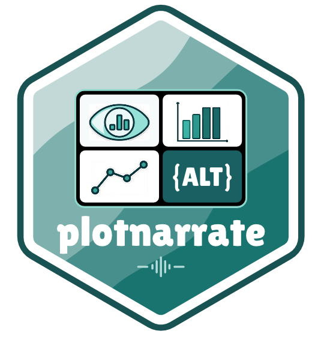
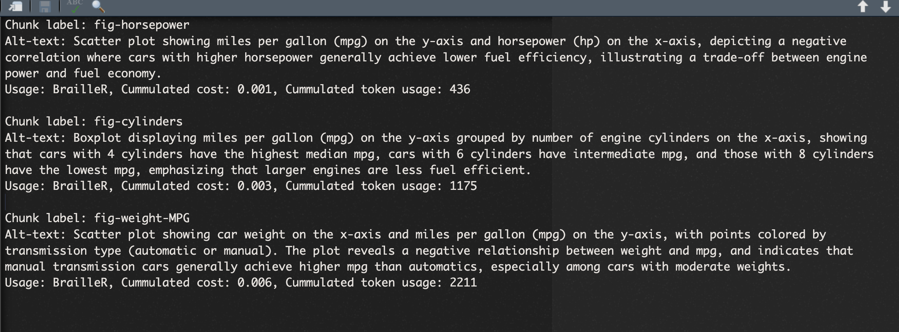

# plotnarrate <a href="https://numbats.github.io/plotnarrate/"></a>

Plotnarrate is a demo R package for automatically generating alt-text from QMD and RMD files. It includes the `generate_alt_text()` function, which uses Ellmer and BrailleR to create alt-text for plots in your documents.

# Install

You can install the development version from GitHub:

```
remotes::install_github("numbats/plotnarrate")
```

It depends on having [BrailleR](https://github.com/ajrgodfrey/BrailleR) which needs to be installed from GitHub.

# Usage

To get started, you will need to get an API key for OpenAI from https://platform.openai.com/api-keys. The `generate_alt_text()` functions support two input workflows:

1. **Quarto and R Markdown documents** (.qmd, .rmd): Extracts plotting code and associated reference text to generate alt-text.
2. **Image files** (.png, .jpg, .jpeg): Generates alt-text directly from images, with the option to provide reference captions or combine multiple images into a single description.

## Generating alt-text from Quarto and R Markdown documents

Provide the file path and name for the `qmd` or `Rmd` file you want to process, and an output file path and name. Ensure that all code required to generate graphics is included in the same file. This github repo comes with a `test.qmd` file in the `inst` folder to get you started.

```
plotnarrate::generate_alt_text(flnm = "inst/test.qmd",
                               outfile = "inst/test-out.txt", 
                               api = api)
```

The generate_alt_text() function scans the document for code chunks containing ggplot, geom, and aes, identifying the source code that generates plots. It extracts the chunk label and uses it to locate the corresponding reference paragraph in the text, and sends requests to ChatGPT via Ellmer, combining: the output from BrailleR (when applicable), and a custom system prompt.

In cases where the example is not self-contained, OpenAI's code interpreter is used in place of BrailleR to understand the code and generate alt-text. Output will be saved in a separate `alt-text.txt` file as seen below. The generated alt-text is saved in a separate file called alt-text.txt, as shown below:



## Generating alt-text from image files

You can also provide existing image files directly without requiring the original plotting code. Supported formats include PNG (.png) and JPEG (.jpg, .jpeg). By default, each image is processed separately, producing an individual alt-text description.

```
plotnarrate::generate_alt_text(flnm = "inst/plot.png",
                               outfile = "inst/alt-text.txt", 
                               api = api)
```

### Providing reference captions

You can optionally provide reference captions to give the model additional context about the visualisation. Captions can be supplied as a character string or a named character vector.

```
plotnarrate::generate_alt_text(flnm = "inst/plot.png",
                               outfile = "inst/alt-text.txt",
                               captions = "Relationship between temperature and pressure.",
                               api = api)
```
A single caption can be applied to all input images. Alternatively, you can provide individual captions for each image, either in the same order as the input files or by naming them with their corresponding file names.

### Combining multiple images

When a figure consists of multiple panels or related visualisations, you can set combine = TRUE to process all supplied images together and generate a single description covering the figure as a whole.

```
plotnarrate::generate_alt_text(
                               flnm = c("inst/panel_a.png", "inst/panel_b.png"),
                               outfile = "inst/alt-text.txt",
                               captions = "Comparison of two distributions across different groups.",
                               combine = TRUE,
                               api = api)
```

By default, combine = FALSE, meaning each image is described independently. Set combine = TRUE when the images represent different panels or views of the same figure.

### Additional options

The function also provides options to customise the generated alt-text:

- **openai_model**: Specifies the OpenAI model used to generate alt-text. Defaults to "gpt-5.1".
- **user_instruct**: Allows you to provide additional instructions to customise the style or content of the generated alt-text.
- **outfile**: Specifies the output text file. Defaults to "alt-text.txt" in the current working directory.

For example, you can provide additional instructions to request a particular writing style:

```
plotnarrate::generate_alt_text(
                               flnm = "inst/plot.png",
                               outfile = "inst/alt-text.txt",
                               user_instruct = "Use concise language and focus on the main statistical patterns.",
                               api = api)
```

# Contribute

Disclaimer: This package is in early development. Currently, it only works with QMD and RMD files where all code chunks are contained within a single document. It does not support workflows where code is stored in a separate R script.


